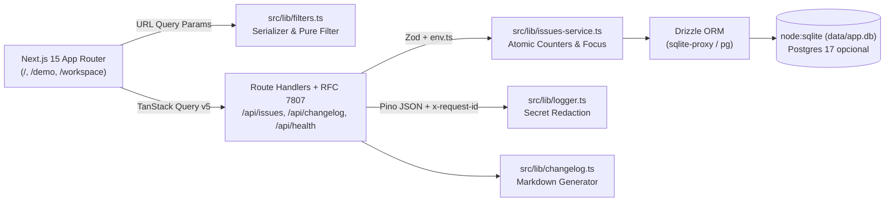

# PulseIssues

[](./.github/workflows/ci.yml)


> **Aviso:** *Proyecto educativo y de portafolio inspirado en Linear. No afiliado a la marca original.*

Issue tracker de ingeniería **standalone** con triaje guiado por teclado (`C`, `/`, `J`, `K`, `Esc`, `Ctrl/Cmd+K`), **Focus Mode Pomodoro** acoplado por issue y **generación determinista de Release Notes** en Markdown.

## Qué hace este proyecto

**PulseIssues** es un gestor de tareas e incidencias para equipos de desarrollo inspirado en Linear. Permite crear, priorizar, etiquetar y filtrar issues guardando los filtros en la URL, navegar todo rápidamente con atajos de teclado, activar un temporizador Pomodoro vinculado a una tarea específica y generar automáticamente notas de lanzamiento (*Release Notes*) en Markdown a partir de los issues completados.

- **Demo en 1 clic**: [`/demo`](/demo) redirige directo al workspace sembrado (`/workspace`) con el proyecto `ENG` (**Pulse Core Platform**), 6 etiquetas N:M y **16 issues (`ENG-101` a `ENG-116`)**.
- **Documentación API interactiva**: [`/api/docs`](/api/docs) (Scalar UI) y [`/api/openapi.json`](/api/openapi.json) (OpenAPI 3.1.0).

---

## Arquitectura del Sistema



---

## Decisiones de Arquitectura (ADRs)

### ADR-01: Estado de filtros sincronizado con URL Query Params
- **Contexto**: Los equipos de ingeniería comparten vistas filtradas (`?status=In+Progress&priority=Urgent&label=Security`) entre PRs y chats sin perder contexto al recargar.
- **Decisión**: `src/lib/filters.ts` actúa como única fuente pura de verdad para parsear, serializar y evaluar filtros, sincronizando el cliente mediante `useSearchParams()` y `router.replace(..., { scroll: false })`.
- **Consecuencia**: Toda vista filtrada es determinista, compartible por enlace y libre de estado duplicado en memoria.

### ADR-02: Contadores atómicos de proyecto para identificadores `ENG-xxx`
- **Contexto**: Calcular el siguiente identificador leyendo `MAX(id)` produce condiciones de carrera o colisiones tras eliminaciones.
- **Decisión**: `projects.issue_counter` se incrementa atómicamente en SQL (`UPDATE projects SET issue_counter = issue_counter + 1 ... RETURNING`) dentro de `createIssue`, derivando `identifier = "${key}-${issueCounter}"`.
- **Consecuencia**: Identificadores monotónicos y únicos bajo concurrencia y borrados.

### ADR-03: Contratos HTTP estrictos (RFC 7807 + OpenAPI 3.1 + Pino)
- **Contexto**: Depurar fallos en producción sin correlación de peticiones o con errores JSON ad-hoc complica la observabilidad y el consumo por clientes.
- **Decisión**: Todas las rutas `/api/*` propagan `x-request-id`, validan entradas con Zod devolviendo `application/problem+json` (`src/lib/problem-details.ts`), registran en JSON con redacción de secretos (`src/lib/logger.ts`) y exponen contratos en `/api/openapi.json` + `/api/docs`.
- **Consecuencia**: Contratos consistentes entre backend, UI optimista (TanStack Query v5) y pruebas automatizadas.

---

## Setup Local en 3 Pasos (`pnpm`)

```bash
# 1. Instalar dependencias
pnpm install

# 2. Migrar esquema y sembrar datos demo (16 issues ENG-101..116)
pnpm db:migrate && pnpm db:seed

# 3. Iniciar servidor de desarrollo en http://localhost:3003
pnpm dev
```

*(Opcional: `docker compose up -d` levanta PostgreSQL 17 en el puerto `5433`; `src/db/schema.pg.ts` contiene el espejo para Postgres.)*

---

## Trade-offs Honestos (100 → 100k registros)

| Dimensión | Implementación actual (~100 issues) | Qué cambia hacia 100k issues |
|---|---|---|
| **Almacenamiento y Concurrencia** | `node:sqlite` local (`data/app.db`) con un único archivo y cero configuración externa. | Migrar a PostgreSQL (`docker-compose.yml` + `src/db/schema.pg.ts`) con pool de conexiones para soportar múltiples réplicas y escrituras concurrentes sin bloqueo de archivo. |
| **Consultas y Filtrado** | `listWorkspaceData` carga issues y aplica `filterIssues()` en memoria + actualización optimista en cliente. | Mover `status`, `priority`, `type`, `label` y búsqueda (`q`) a paginación por cursor en SQL con índices compuestos y `GIN` / FTS5 para texto completo. |
| **Focus y Release Notes** | `CHANGELOG.md` y sumas de `focus_sessions` se calculan bajo demanda en `GET /api/changelog`. | Pre-agregar métricas de tiempo por sprint/release y cachear artefactos de Release Notes generados por tag/fecha. |
